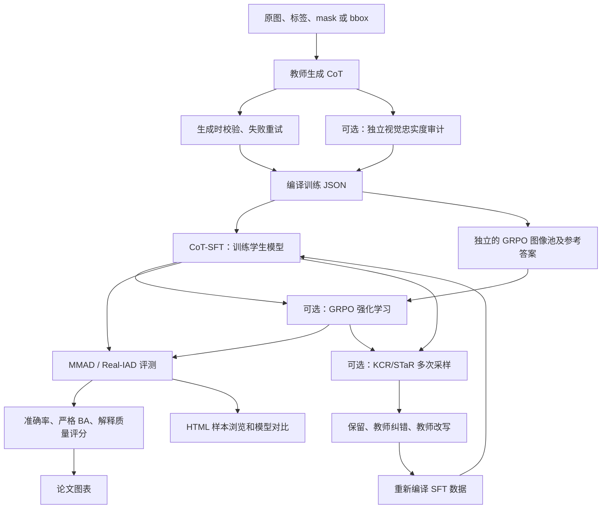

# IAD-VLMs 全项目流程说明：从 CoT 生成到训练、评测和可视化

整理日期：2026-10-30。依据当前工作区的 Python、Shell、YAML、数据文件和已有说明整理。

本文只说明项目，不执行数据生成、训练、付费模型调用、评测或清理操作。文中的命令是运行入口示例，不代表本次已经执行成功。当前已有的代码改动保持不变。

阅读建议：先看第 1 节建立全局认识；衔接你们当前工作重点看第 2、5、6、7.4 和 13 节；了解 HTML 看第 11 节；区分两种 MMAD 用法看第 9、10 节。

## 1. 先建立整体认识

你的理解基本正确：项目可以沿着“CoT 数据生成 → 编译 SFT 数据 → CoT-SFT → GRPO → MMAD 评测”来阅读。但实际还有两个重要部分：一是生成时和生成后的数据质检；二是 KCR/STaR 数据改进循环，即让训练过的模型重新作答，保留可靠答案，让教师纠错和改写，再用这些新答案做一轮 SFT。GRPO、KCR 和可视化都是可选择的分支，并非每个实验必须依次经过。

还要区分两条时间线。原论文的大部分数据和模型来自 Gemini 教师、Real-IAD、Qwen2.5-VL 的历史实验；当前你们主要改动的是本地 Qwen3-VL 的数据生成部分，尤其是 `anomaly_instruct_4/`。新的生成入口已经有编译器，但下游的训练配置、GRPO 奖励、MMAD 评测和 HTML 模板，仍主要服务于历史实验，并未自动全部适配新的四数据集、多视图和 bbox 格式。



### 1.1 每个目录在流程中的位置

| 目录 | 通俗理解 | 主要产物 |
|---|---|---|
| [`scripts/00_generate/`](../scripts/00_generate/) | 请教师看图写检查推理，准备训练素材 | manifest、evidence、`trace_*.json`、编译后的 JSON |
| [`prompts/`](../prompts/) | 历史 Real-IAD 教师的检查说明书 | 教师系统提示词 |
| [`scripts/01_sft/`](../scripts/01_sft/) | 启动监督微调 | checkpoint、训练日志 |
| [`configs/sft/`](../configs/sft/) | 指定学生模型、数据集和训练参数 | YAML 训练配置 |
| [`configs/deepspeed/`](../configs/deepspeed/) | 配置多卡训练和显存/CPU 卸载 | DeepSpeed JSON |
| [`scripts/02_grpo/`](../scripts/02_grpo/) | 模型多次作答，根据奖励继续训练 | GRPO checkpoint、奖励日志 |
| [`scripts/03_rollout_star/`](../scripts/03_rollout_star/) | 重新采样、筛选、教师纠错和改写 | rollout、分桶结果、新 SFT 数据 |
| [`scripts/04_eval/`](../scripts/04_eval/) | 常规测试，以及模型输出解释质量评分 | 逐样本评测 JSON、评分汇总 |
| [`scripts/05_figures/`](../scripts/05_figures/) | 将结果转换为 HTML、图片和论文图表 | HTML、PNG、SVG、PDF、表格 |
| [`scripts/06_mmad/`](../scripts/06_mmad/) | MMAD 数据参与训练的独立实验 | MMAD CoT、训练/测试划分、评测结果 |
| [`audit/`](../audit/) | 已完成历史数据审计的代码、记录和修订数据构建器 | `audit_grounding.jsonl`、AnomalyThink-v2 |
| [`traces/`](../traces/) | 随项目保存的历史训练语料 | ShareGPT JSON、GRPO JSON、审计修订语料 |
| [`docs/trace_viewers/`](trace_viewers/) | 单模型、单 benchmark 的样本浏览页 | 已嵌入图像的历史 HTML |
| [`docs/interactive/`](interactive/) | 历史模型对比、流程说明和人工审查材料 | HTML、流程图 PNG/PDF |

### 1.2 阅读命令前，先理解路径约定

下面未另外说明的命令都从仓库根目录执行：

```bash
cd /mnt/data/wangzijian/second_stage_work/code/IAD-VLMs
```

需要特别注意三点：

1. 当前仓库根目录下没有 `results/` 和 `outputs/`，虽然 README、RUNBOOK、HTML 和绘图脚本多次提到它们。已有 HTML 能独立打开，并不意味着原始评测 JSON 和模型权重也保存在当前仓库。
2. 很多历史脚本硬编码 `/bulk/aacudad/reasoning_traces/`，还会调用旧的 `Training/`、外部 `LlamaFactory/` 和旧 conda 环境。本文将这类命令标成“历史入口，需迁移路径”。单纯设置 `WORK_DIR` 不能覆盖所有硬编码路径。
3. 历史数据中的图像路径也不统一：实际抽查 `traces/anomalythink_6k/` 是 `/bulk/...` 绝对路径，`traces/mmad/` 是 `MMAD/...` 相对路径。以实际 JSON 为准，不能照搬旧说明中“全部为相对路径”的说法。

本文中的 `/path/to/...` 是需要自行指定的路径；`WORK_DIR` 指包含数据、训练输出及外部工具的工作目录，不天然等于仓库目录。

## 2. CoT 生成阶段之一：当前 Anomaly-Instruct 四数据集路线

这是你们近期工作的重点。入口在 [`scripts/00_generate/anomaly_instruct_4/`](../scripts/00_generate/anomaly_instruct_4/)，来源为 Prism 中的 Anomaly-Instruct-125K，但只处理有像素定位监督的 MVTec AD、Anomaly-ShapeNet、MVTec3D、Real3D。源数据目录只读，生成的索引、bbox 提示图、evidence 和 CoT 写入当前子目录的 `data/`。

### 2.1 先建立样本清单

首先通过 `build_mvtec3d_bboxes.py` 给 MVTec3D 生成 bbox 轮廓提示图，再通过 `prepare_manifests.py` 生成去重的 manifest。manifest 可以理解为“生成任务清单”：它记录每个样本有哪些原始视图、正常参考图、标签、类型、mask 和 GT bbox，后续生成器按它逐条工作。

```bash
cd scripts/00_generate/anomaly_instruct_4
python build_mvtec3d_bboxes.py
python prepare_manifests.py
python audit_manifests.py
```

| 文件 | 负责什么 |
|---|---|
| [`config.py`](../scripts/00_generate/anomaly_instruct_4/config.py) | 源数据、输出、缓存、模型路径和推理参数 |
| [`dataset_utils.py`](../scripts/00_generate/anomaly_instruct_4/dataset_utils.py) | 去重、路径解析、类型归一化、mask 转 bbox、参考图匹配 |
| [`build_mvtec3d_bboxes.py`](../scripts/00_generate/anomaly_instruct_4/build_mvtec3d_bboxes.py) | 为 MVTec3D 补充纯 bbox 轮廓提示图 |
| [`prepare_manifests.py`](../scripts/00_generate/anomaly_instruct_4/prepare_manifests.py) | 将源指令整理成按样本去重的生成清单 |
| [`audit_manifests.py`](../scripts/00_generate/anomaly_instruct_4/audit_manifests.py) | 检查 ID、图像和监督文件、计数、类型来源以及教师图像中是否混入 mask |

主要结果为：

```text
scripts/00_generate/anomaly_instruct_4/data/
├── derived_bbox/                 # 新生成的 bbox 提示图
└── manifests/
    ├── mvtec_ad.json
    ├── anomaly_shapenet.json
    ├── mvtec3d.json
    └── real3d.json
```

本次读取到的 manifest 数量如下。这是任务清单数量，不是已经通过校验的 CoT 数量，也不意味着已经完成训练/测试划分。

| 数据集 | 样本总数 | 异常 | 正常 |
|---|---:|---:|---:|
| MVTec AD | 5,354 | 1,258 | 4,096 |
| Anomaly-ShapeNet | 1,924 | 936 | 988 |
| MVTec3D | 3,843 | 941 | 2,902 |
| Real3D | 1,254 | 602 | 652 |
| 合计 | 12,375 | 3,737 | 8,638 |

`audit_manifests.py` 默认把检查结果输出到终端，不自动保存独立报告。可以重定向终端输出保存记录，但不能把它当作 CoT 内容忠实度评分。

### 2.2 直接生成 CoT 的基线入口

通过 [`generate_traces_qwen3vl.py`](../scripts/00_generate/anomaly_instruct_4/generate_traces_qwen3vl.py)，本地 Qwen3-VL 接收原始查询图、异常 bbox 提示图和同类别正常参考图，再参考 GT 答案、类型和 bbox 坐标，写出结构化推理。提示词在 [`prompt_anomaly_instruct_4.txt`](../scripts/00_generate/anomaly_instruct_4/prompt_anomaly_instruct_4.txt)。

```bash
# 本节命令仍在 scripts/00_generate/anomaly_instruct_4/ 下执行
python generate_traces_qwen3vl.py --debug --datasets mvtec_ad --max-samples 2
CUDA_VISIBLE_DEVICES=0 python generate_traces_qwen3vl.py --datasets mvtec_ad
```

`--debug` 用于检查请求，不加载 vLLM 做正式推理。正式生成支持分片，例如 `--shard-id 0 --total-shards 4`；各分片需使用一致的筛选条件。成功样本保存到：

```text
data/traces_qwen3vl8b/<dataset>/trace_<sample_id>.json
```

记录包含 `reasoning` 和 `validation` 等信息。生成阶段有 GT 提示，因此这里衡量的是“教师能否构建合格训练答案”，不能将其通过率当成模型零样本异常检测或定位精度。

### 2.3 当前 evidence-first 两阶段入口

[`generate_traces_qwen3vl_evidence_first.py`](../scripts/00_generate/anomaly_instruct_4/generate_traces_qwen3vl_evidence_first.py) 将工作拆成两次推理。第一次先描述看见了什么，第二次再结合图像、已保存的证据和 GT 监督，组织成最终 CoT。两次推理复用同一个冻结的本地 Qwen3-VL/vLLM 引擎，不进行参数训练。

第一阶段不提供缺陷类型、最终标签、源描述和文本 bbox 坐标，但仍提供源自标注的 bbox 提示图，因此它是“类型盲、区域引导”的观察，并非完全无 GT。第二阶段重新看图并接收完整监督，生成与基线相同格式的 CoT。两个阶段的提示词分别是 `prompt_anomaly_instruct_4_stage1_evidence.txt` 和 `prompt_anomaly_instruct_4_stage2_evidence_anchored.txt`。

```bash
python generate_traces_qwen3vl_evidence_first.py

# 只在一个数据集上生成少量剩余样本
python generate_traces_qwen3vl_evidence_first.py --datasets mvtec_ad --max-samples 8

# 分别执行两个阶段
python generate_traces_qwen3vl_evidence_first.py --stage evidence
python generate_traces_qwen3vl_evidence_first.py --stage cot
```

输入输出关系是：

```text
data/manifests/<dataset>.json
  → 第一阶段观察
data/evidence_qwen3vl8b/evidence_<dataset>.json
  → 第二阶段组织 CoT，并做结构校验
data/traces_qwen3vl8b_evidence_first/traces_<dataset>.json
```

evidence JSON 保存 `object_observation`、各视图区域观察、正常图对比、可见性和不确定性。最终 trace JSON 保存 `reasoning`、`validation` 和生成元数据。它们按数据集聚合保存，不是每个样本一个文件；加载时同一 ID 取最后一条记录。相关持久化逻辑在 [`dataset_json_store.py`](../scripts/00_generate/anomaly_instruct_4/dataset_json_store.py)。

中断后重复原命令即可复用已保存 evidence、跳过有效最终 trace；`--stage cot` 缺 evidence 时会报错，不会自行补跑第一阶段。失败日志在 `data/traces_qwen3vl8b_evidence_first/failed/`。运行期间不要删除相邻 `.json.lock` 文件；并发读取应使用该模块的 `read_records()`。

### 2.4 本路线如何做质量检查

核心校验器是 [`validate_trace.py`](../scripts/00_generate/anomaly_instruct_4/validate_trace.py)，生成器在推理后调用，失败时带反馈重试；编译器会再校验一次。当前生成/编译入口默认要求：

- 正常样本只有 `<think>...</think><answer>No</answer>`；异常样本依次为 `think → location → type → answer`，答案为 Yes。
- `<think>` 为 80–220 词，类型与提供的规范类型一致。
- 2D 输出原图像素 bbox；多视图输出带 `view_id` 的 bbox 列表，必须覆盖有 GT bbox 的视图。
- 每个预测框与 GT 框的 IoU 必须严格大于 0.9；坐标必须处于原图内。
- 禁止在推理文字中直接提及标注、mask、提供的红框、正常参考图等教师辅助信息。

这里的 0.9 来自生成/编译入口传入的配置；校验函数自身的备用默认值是 0.5，不能只看函数签名就认定正式流程使用 0.5。

```bash
python -m unittest test_pipeline.py test_evidence_first_pipeline.py
```

这些测试验证管线逻辑；规则校验验证结构和与 GT 的一致性。两者都不能独立证明每句视觉描述真实。当前 evidence-first 流程也没有自动接入下面介绍的 Gemini 全量忠实度审计。

## 3. CoT 生成阶段之二：Real-IAD 本地 Qwen3-VL 路线

这条路线在 [`scripts/00_generate/realiad_v4/`](../scripts/00_generate/realiad_v4/)。它沿用 Real-IAD 的 C1 单视角、mask 和正常参考图，目标是构建互不重叠的约 3K SFT 与 3K GRPO 源样本。它与历史 `traces/anomalythink_6k/` 不是同一轮生成任务，不能因为都涉及“6K”就认为能复现历史 checkpoint。

### 3.1 从原图到源样本索引

```bash
cd /mnt/data/wangzijian/second_stage_work/code/IAD-VLMs/scripts/00_generate/realiad_v4
python download_realiad.py
python sample_realiad_v4.py
```

`download_realiad.py` 准备 `data/Real-IAD/` 下的图像；`sample_realiad_v4.py` 选择 C1 图像，异常样本要求存在 mask，按产品分层并尽量保持正常/异常均衡。两份索引为：

```text
3k_realiad_v4/sft_train.json
3k_realiad_v4/grpo_train.json
```

此时 assistant 内容或 `answer` 为空，只是等待教师填写的样本清单。代码目标为每份 3,000，最终数量需看采样日志和实际文件，不能仅根据文件夹名判断。

### 3.2 生成并保存 CoT

```bash
python -m unittest test_validate_structured_trace.py
python generate_realiad_traces_qwen3vl.py --debug --max-samples 2
CUDA_VISIBLE_DEVICES=0 OMP_NUM_THREADS=1 python generate_realiad_traces_qwen3vl.py

# 或者多 GPU、每 GPU 一个模型副本和一个数据分片
GPU_LIST=0,1,2,3 bash run_qwen3vl_generate.sh
```

当前主入口是 [`generate_realiad_traces_qwen3vl.py`](../scripts/00_generate/realiad_v4/generate_realiad_traces_qwen3vl.py)；`generate_realiad_traces_v4.py` 只是兼容旧名字的启动器。`config_qwen3vl.py` 决定路径和推理默认值，`utils_realiad.py` 构建红色 mask overlay、匹配正常参考和计算位置，系统提示词来自仓库 `prompts/inspector_prompt_test_v2.txt`。

异常样本给教师原图、红色 mask overlay 和正常参考图；正常样本只给原图。成功记录分别保存到：

```text
data/output/reasoning_traces_realiad_qwen3vl8b/sft/trace_<id>.json
data/output/reasoning_traces_realiad_qwen3vl8b/grpo/trace_<id>.json
data/output/reasoning_traces_realiad_qwen3vl8b/failed/...
```

[`validate_structured_trace.py`](../scripts/00_generate/realiad_v4/validate_structured_trace.py) 检查 XML 标签、120–200 词、答案、类型、mask 对应的九宫格位置和辅助信息泄漏。失败会重试并记录原因。它使用 `top-left` 等九宫格文字位置，与四数据集路线的 bbox 坐标格式不同。

## 4. 生成后的独立质量审计：检查“文字是否真的对应图像”

生成时的规则校验主要检查格式、标签和位置一致性。若要检查“是否编造零件特征、数错引脚、把 mask 红色当缺陷、描述了错误区域”，项目还提供独立视觉审计。它们默认针对历史 Real-IAD 数据格式；不能只换路径就当作已经支持新四数据集多视图语料。

### 4.1 可重新运行的 `trace_audit` 工具链

工具在 [`scripts/00_generate/trace_audit/`](../scripts/00_generate/trace_audit/)。先构建统一 corpus，把每条 CoT 与对应原图、mask、正常参考和 GT 对齐；再做不调用模型的格式检查；最后由 Gemini 审查视觉描述并汇总结果。

```bash
# 仓库根目录；先确保 JSON 内图像路径和真实数据对应
export SFT_JSON=/path/to/sft_train.json
export GRPO_JSON=/path/to/grpo_train.json
export REALIAD_IMAGES=/path/to/Real-IAD/images

python scripts/00_generate/trace_audit/build_corpus.py
python scripts/00_generate/trace_audit/format_check.py

# 需事先配置 GEMINI_API_KEY；这是会调用远端模型的入口
python scripts/00_generate/trace_audit/audit_traces_gemini.py \
  --prompt scripts/00_generate/trace_audit/prompt_grounding_v2.txt \
  --out scripts/00_generate/trace_audit/audit_grounding.jsonl

python scripts/00_generate/trace_audit/countable_check.py
python scripts/00_generate/trace_audit/aggregate_report.py
```

| 程序 | 检查内容 | 输出位置，相对 `scripts/00_generate/trace_audit/` |
|---|---|---|
| `build_corpus.py` | 解析两份训练池，匹配原图、mask 和参考图 | `corpus.jsonl` |
| `format_check.py` | 标签存在与顺序、正常样本额外标签、答案可解析性和标签一致性 | `format_check.jsonl`，并打印统计 |
| `make_calib_sample.py` | 抽取分层校准集，先检查审计器是否可信 | `calib_200.jsonl` |
| `audit_traces_gemini.py` | 看原图/overlay/参考图检查视觉声明和幻觉，给问题类别及可能的修订文字 | 默认 `audit_grounding.jsonl`，另有错误记录 |
| `countable_check.py` | 对已知可计数部件做确定性文字计数核查，主要针对 transistor1 | `countable_check.jsonl` |
| `aggregate_report.py` | 先报告覆盖率，再统计审计类别、问题类型等 | `audit_report.md` |

`run_full_sweep.sh` 是历史 10,236 条语料的审计驱动器，包含顺序分片、失败重试和固定总量；新数据量变化时需重新核对，不能直接沿用固定总量。`analyse_calib.py`、`selfconsistency.py`、`compare_v1_v2.py`、`extrapolate.py` 分别用于校准分析、一致性、提示词比较和规模估计。

审计结果是教师模型的判定，不是人工确认的真实错误率。项目说明记录了类型边界、九宫格边界、计数和单次判定波动等局限。判断模型是否变好，应结合人工抽查和独立测试，不能只看审计分数。

### 4.2 已保存的历史审计：`audit/` 和 AnomalyThink-v2

[`audit/audit_grounding.jsonl`](../audit/audit_grounding.jsonl) 当前实际保存了 10,236 条历史审计记录：7,872 条 `completely_correct`、2,047 条 `wrong`、317 条 `completely_wrong`。这些是已保存文件的实读统计，不是本次重新调用 Gemini 的结果。

[`audit/build_anomalythink_v2.py`](../audit/build_anomalythink_v2.py) 将审计修订应用到原 6K SFT 数据，形成“原图和问题不变，只修订 assistant 推理”的对照语料。现有产物在：

```text
traces/anomalythink_v2/anomalythink_v2_train.json
traces/anomalythink_v2/anomalythink_v2_manifest.jsonl
```

manifest 实读为 5,042 条保留、950 条修订、8 条无法修订而保留原文。`audit/` 的 builder 仍硬编码旧 `Training/` 路径；它与较可配置的 `scripts/00_generate/trace_audit/` 是不同副本，不要认为二者输出目录天然相同。恢复历史路径后，相关入口是：

```bash
# 历史入口，需先迁移路径
python audit/build_corpus.py
python audit/audit_traces_gemini.py --out audit/audit_grounding.jsonl
python audit/build_anomalythink_v2.py
```

这里 `audit/build_corpus.py` 的输出仍由它内部的 `OUT` 决定，后两步的输入也要一并对齐。当前已经有修订后的训练 JSON，不必为了理解或使用语料重新跑付费审计。

### 4.3 另外几份验证脚本

[`scripts/verify_traces_openai_original.py`](../scripts/verify_traces_openai_original.py)、[`scripts/verify_6k_traces.py`](../scripts/verify_6k_traces.py)、[`scripts/verify_15k_traces.py`](../scripts/verify_15k_traces.py) 使用远端视觉模型检查格式、图像匹配、逻辑和泄漏，保存逐条 `verify_*.json` 与汇总。

它们属于历史辅助入口，输入、输出及凭据路径需要检查。尤其当前 `verify_6k_traces.py` 实际 `CORPUS` 指向旧 `15k_dataset_regenerated/combined_sft_train.json`，不能凭文件名认为它检查 6K。其默认输出是旧工作目录 `outputs/verify_6k_results/`；`verify_15k_traces.py` 输出到 `outputs/verify_15k_regen_results/`。

## 5. 编译阶段：把合格 CoT 变成能训练的数据

“CoT 生成”和“编译 SFT 数据”是两个动作。生成产物带任务 ID、辅助监督、校验和推理元数据；训练文件主要保留查询图、用户问题和目标回答。编译器负责把二者对齐，并移除不应成为学生输入的教师辅助材料。

### 5.1 四数据集编译

```bash
cd /mnt/data/wangzijian/second_stage_work/code/IAD-VLMs/scripts/00_generate/anomaly_instruct_4

# 编译直接生成的基线结果
python compile_traces.py

# 编译 evidence-first 结果
python compile_traces.py --trace-source evidence-first

# 明确允许只编译已有合格样本的小规模试运行
python compile_traces.py --trace-source evidence-first --datasets mvtec_ad --allow-missing
```

[`compile_traces.py`](../scripts/00_generate/anomaly_instruct_4/compile_traces.py) 逐样本重新校验 CoT。默认缺失或不合格就失败；`--allow-missing` 才允许局部数据集。输出为：

```text
data/compiled/<dataset>_cot_sft.json
data/compiled/<dataset>_evaluation_sidecar.json

# evidence-first 对应
data/compiled_evidence_first/<dataset>_cot_sft.json
data/compiled_evidence_first/<dataset>_evaluation_sidecar.json
```

前者是 SFT 数据，形如：

```json
{
  "id": "sample_id",
  "images": ["/path/to/query_view_1.png", "/path/to/query_view_2.png"],
  "messages": [
    {"role": "user", "content": "<image><image>\n检查问题"},
    {"role": "assistant", "content": "<think>检查推理</think><location>...</location><type>...</type><answer>Yes</answer>"}
  ]
}
```

这里只保留原始查询图，视图数与 `<image>` 数一致。GT 框、mask、bbox 提示图和参考图不会作为学生输入；GT 框仍可出现在目标回答的 `<location>` 中，这是定位监督。sidecar 单独保存 GT、视图和生成校验结果，便于后续评估；它不是已经实现的评测器，也不是自动划分出的测试集。

### 5.2 Real-IAD v4 编译

```bash
cd /mnt/data/wangzijian/second_stage_work/code/IAD-VLMs/scripts/00_generate/realiad_v4
python compile_traces_v4.py
```

[`compile_traces_v4.py`](../scripts/00_generate/realiad_v4/compile_traces_v4.py) 将源索引与有效 trace 匹配，重新核对类型、位置及标签，并输出：

```text
realiad_qwen3vl8b_compiled/sft_train.json
realiad_qwen3vl8b_compiled/grpo_train.json
```

`sft_train.json` 是 `messages + images` 格式；`grpo_train.json` 是 `image_id、image_path、product、is_anomaly、question、answer、gt_label` 格式，`answer` 存参考完整 trace。GRPO 不把这段参考 trace 当作用户输入，而是在奖励计算时从中解析 GT 答案、类型和位置。

一个实现细节：Real-IAD 编译器先写出已匹配子集，再检查缺失数量并以非零状态退出。因此“目录里存在输出 JSON”不代表全量编译成功，还要检查退出状态和 Missing 统计。四数据集编译器则在单个数据集写出之前先检查是否允许缺失。

### 5.3 项目已有历史语料分别是什么

| 路径 | 实读数量/用途 |
|---|---|
| `traces/anomalythink_6k/combined_6k_train.json` | 6,000 条，历史 6K CoT-SFT 语料 |
| `traces/anomalythink_15k/combined_sft_train.json` | 14,472 条，历史大池/15K SFT 对照语料 |
| `traces/anomalythink_15k/grpo_train.json` | 4,236 条，发布语料中的 GRPO 分区，含再生成参考 trace |
| `traces/grpo_split/grpo_train.json` | 4,236 条，README 标明为历史 GRPO 训练实际使用版本 |
| `traces/teacher_ablation_abc/sft_A_kept_balanced.json` | 2,978 条，Qwen Arm A，保留模型通过筛选的答案 |
| `traces/teacher_ablation_abc/sft_B_kept_corrected.json` | 4,369 条，Qwen Arm B，保留 + 教师纠错 |
| `traces/iter2/sft_iter2_train.json` | 6,000 条，Qwen Arm C/KCR，保留 + 纠错 + 改写 |
| `traces/anomalythink_v2/anomalythink_v2_train.json` | 6,000 条，历史教师语料经独立审计修订后的版本 |

两份 4,236 条的 GRPO 文件图像及顺序相同，但本次比较发现所有 `answer` 字符串都不同。复现历史训练与使用发布版新 trace 是两件事，不能只因样本数相同就互换。历史大池各分区还涉及 held-out 数据，做新的实验应明确建立互不重叠的 SFT、GRPO、验证和测试集合。

## 6. CoT-SFT 阶段：让学生学习“看查询图 → 写推理和结论”

真正的 SFT 主要交给外部 LLaMA-Factory 执行。本仓库提供训练 YAML、数据注册表和启动脚本，没有在 `01_sft/` 中重新实现完整 SFT Trainer。教师可以是本地 Qwen3-VL，学生可以是 Qwen2.5-VL、Qwen3-VL 或 LLaVA；教师模型与学生模型不必相同。

### 6.1 训练之前先注册数据

[`configs/dataset_info.json`](../configs/dataset_info.json) 把逻辑数据集名映射到训练 JSON，`configs/dataset_info_additions.json` 是其他实验的增量注册项。比如 YAML 中 `dataset: iad_sft_6k_train` 需要在实际使用的 LLaMA-Factory 数据目录中找到同名注册项。

对于新的四数据集结果，当前注册表没有对应的完整新训练配置。接入时需要为每份 `*_cot_sft.json` 注册 ShareGPT 映射，例如下面是配置内容示意，不是本次新建的文件：

```json
{
  "mvtec_ad_cot_evidence_first": {
    "file_name": "/absolute/path/to/mvtec_ad_cot_sft.json",
    "formatting": "sharegpt",
    "columns": {"messages": "messages", "images": "images"},
    "tags": {
      "role_tag": "role", "content_tag": "content",
      "user_tag": "user", "assistant_tag": "assistant"
    }
  }
}
```

然后在训练 YAML 中指定该 dataset、正确的 `dataset_dir`、学生模型及 template、DeepSpeed 配置和输出目录。多个数据集如何混合、是否均衡采样、哪些图像保留作测试，是需要明确设置的实验方案，当前编译器不会替你做完。

### 6.2 历史 Qwen2.5-VL 6K 配方

核心配置 [`sft_qwen25vl_7b_zeroshot_6k_frozen.yaml`](../configs/sft/sft_qwen25vl_7b_zeroshot_6k_frozen.yaml) 使用 Qwen2.5-VL-7B、`qwen2_vl` template、full 微调、冻结视觉塔，训练 projector 和语言模型，4 个 epoch、学习率 `1e-5`、bf16 和 DeepSpeed ZeRO-3 CPU offload。

```bash
# 历史入口，需先迁移 YAML 内的 deepspeed/output_dir 和数据注册路径
CUDA_VISIBLE_DEVICES=0,1 FORCE_TORCHRUN=1 \
  llamafactory-cli train configs/sft/sft_qwen25vl_7b_zeroshot_6k_frozen.yaml
```

对应包装脚本是 `scripts/01_sft/run_sft_qwen25vl_7b_zeroshot_6k_frozen.sh`，但它内部切换旧工作目录、调用旧 conda 环境和 YAML；文件顶部“2 epochs、全视觉塔训练”的旧注释也与 YAML 不一致。应以 YAML 的实际参数为准。

训练产物由 YAML 的 `output_dir` 决定，历史默认类似：

```text
/bulk/aacudad/reasoning_traces/outputs/sft_qwen25vl_7b_zeroshot_6k_frozen/
├── checkpoint-<step>/            # 权重和模型/处理器配置
└── ...                          # 训练状态与日志，具体取决于保存选项
```

`checkpoint-564` 是历史 run 的步数名称，不是重新训练一定出现的名字。数据量、GPU 数和 batch 改变后步数也会改变。部分配置启用 `save_only_model: true`，只保存模型，不保证具备完整 optimizer 状态来严格断点续训。

### 6.3 其他 SFT 分支

| 训练目的 | 配置或入口 | 说明 |
|---|---|---|
| Qwen A/B/C 数据改进对照 | `configs/sft/sft_abc_A.yaml`、`sft_abc_B.yaml`、`sft_abc_C.yaml`；`run_abc_train.sh A "0,1"` | Arm C 注册名是 `iad_sft_iter2`；ABC 从 base 做比较 |
| Qwen3-VL 学历史 Arm C | `configs/sft/sft_qwen3vl_8b_armC.yaml`；`bash scripts/01_sft/run_qwen3vl_8b_armC.sh "0,1"` | launcher 展开 `${WORK_DIR}`/`${REPO_ROOT}`；默认仍训练历史 Arm C，不会自动读新 evidence-first 语料 |
| LLaVA backbone 对照 | `bash scripts/01_sft/run_sft_llava_ov_7b_frozen.sh iad_sft_6k_train 0,1` | 使用外部 IAD-R1 的 stage_sft/LLaMA-Factory 分支和指定环境 |
| 3B/7B、15K、视觉塔解冻 | `configs/sft/` 下相应 YAML 和 `01_sft/run_sft_*` | 模型容量、数据规模和冻结策略对照 |
| 不训练推理、只训练标签 | `scripts/01_sft/build_noreason_dataset.py`、`sft_qwen25vl_7b_6k_noreason.yaml` | 检验 CoT 是否带来收益 |

因此，你们生成完新数据后，下一步应是独立准备一份对应的新数据注册和 SFT 配置，而不是直接启动名字相近的旧脚本。

## 7. GRPO 阶段：让模型多次作答，并偏向高奖励的答案

SFT 直接学习给定答案；GRPO 会对同一图像采样多个答案，计算格式、结论、类型、位置等奖励，在同一组答案之间比较后更新模型参数。它依赖已有模型和独立图像池，参考 CoT 用于奖励监督。

### 7.1 哪些文件构成 GRPO

| 文件 | 作用 |
|---|---|
| [`stage_rl/grpo_ad.py`](../scripts/02_grpo/stage_rl/grpo_ad.py) | 训练入口，读数据、构造 prompt、选择 reward 和 Trainer |
| [`stage_rl/configs.py`](../scripts/02_grpo/stage_rl/configs.py) | 扩展 TRL GRPOConfig，支持 G²RPO、Dr.GRPO 等研究选项 |
| [`trainer/sc_grpo_trainer.py`](../scripts/02_grpo/stage_rl/trainer/sc_grpo_trainer.py) | 多次生成、奖励汇总、组内 advantage、KL 与模型更新 |
| [`stage_rl/reward.py`](../scripts/02_grpo/stage_rl/reward.py) | 结论/类型/位置、格式及可选 reasoning judge 奖励 |
| [`reward_process/type_reward.py`](../scripts/02_grpo/stage_rl/reward_process/type_reward.py) | Nomic embedding 语义相似度及阈值映射，服务失败时可退回词面相似度 |
| [`reward_process/location_reward.py`](../scripts/02_grpo/stage_rl/reward_process/location_reward.py) | 根据 top/bottom/left/right 等文字比较九宫格位置 |
| `judge_server.py` | 本地推理文字评分服务，默认端口 5100 |
| `gemini_judge_server.py`、`gemini_judge_server_v2.py` | 视觉教师评分服务，v2 同时提供 `/embed_similarity`，默认端口 5200 |
| `run_grpo_*.sh` | 指定初始 checkpoint、数据、GPU 和训练参数的历史启动脚本 |

### 7.2 当前源码中的奖励究竟是什么

默认 `reward_funcs` 是 `accuracy、format、reasoning`。其中 `accuracy_reward` 已经包含答案、类型和位置；`format` 映射到 `consistency_reward`；`reasoning` 会请求外部文字评分服务，失败时有效推理可得到中性分值。当前 Trainer 将各 reward 函数直接求和。

默认未打开额外奖励开关时，正常样本答对得到 accuracy 1；异常样本大致为 `是否答 Yes + (类型分 + 位置分)/2`；格式再单独检查。`REWARD_GATE_TAGS`、`REWARD_BAND_FORM`、`REWARD_COMPONENTS` 等环境变量能改变这一行为，`test_reward_gating.py` 是相应测试。

这与 RUNBOOK 中“固定四项权重 0.3/0.3/0.2/0.2”等历史文字不能直接画等号。旧启动脚本有的也没有显式写 `beta` 和 `learning_rate`，实际值会受当时 TRL 配置影响。本文不把旧文字和当前源码拼成一个声称可精确复现历史结果的配置。

### 7.3 命令入口与产物

历史先启动相关评分服务，再运行训练脚本，例如：

```bash
# 需要凭据、依赖及服务配置；该服务启动本身会检查远端 API
JUDGE_PORT=5200 python scripts/02_grpo/gemini_judge_server_v2.py

# 历史入口：先核对并迁移脚本内所有绝对路径
bash scripts/02_grpo/run_grpo_7b_6k_frozen_ep3.sh
bash scripts/02_grpo/run_grpo_7b_resume_run2.sh

# 或以 Arm C 为初始化
bash scripts/02_grpo/run_grpo_abc_C_4gpu.sh
```

这些包装器最终通过 `torchrun .../grpo_ad.py` 启动。关键参数为 `--model_name_or_path`、`--dataset_name`、`--output_dir`、`--num_generations`、`--max_completion_length` 等；核心入口会调用 `trainer.train()` 并在 `output_dir` 保存模型。

历史输出包括 `outputs/<grpo_run>/checkpoint-<step>/`、`train.log` 和启用调试时的 `reward.log`。run2 脚本通过 `--model_name_or_path` 加载 run1 checkpoint，是从其权重继续训练；脚本没有传入 `--resume_from_checkpoint`，因此不能描述为自动恢复了所有优化器状态。

### 7.4 新四数据集不能直接接旧 GRPO 的原因

当前 `location_reward.py` 只查找 top、bottom、left、right 等文字，不能计算 bbox IoU。若把纯数值 bbox 字符串传给它，预测和 GT 都可能被映射到默认中心格，产生没有定位意义的奖励。旧数据装载和图像处理也围绕单图/参考图模式设计，没有完整适配你们新的多视图 schema。

此外，四数据集编译器只产出 SFT JSON 和 sidecar，没有产出旧 GRPO 所需的逐项 schema，也没有自动分离 GRPO 图像池。因此“新数据 → GRPO”仍需要格式转换、数据划分、多视图处理及 bbox 奖励适配。当前阶段可先做新数据 CoT-SFT 和对应评测，不能把旧 GRPO 启动脚本视为已经接通。

## 8. KCR/STaR 阶段：用已有模型改进下一轮 SFT 数据

KCR 是 Keep、Correct、Revise：模型已经能可靠回答的样本保留自己的推理；一直回答失败的样本让教师纠错；结论通过但描述弱或有幻觉的样本让教师改写。这是在改进训练答案，不是一次 GRPO 更新。历史 Qwen 路线常以 SFT+GRPO 模型作为采样策略，再让 base 模型学习新语料；也存在从不同初始 checkpoint 继续 SFT 的对照，不应混为同一个实验。

### 8.1 先采样，再分桶

```bash
# 历史入口：phase0 文件的 reward 导入路径需先迁移；图像路径及评分服务需已就绪
python scripts/03_rollout_star/phase0_rollout_kscoring.py \
  --model_path /path/to/policy_checkpoint \
  --sft_pool traces/anomalythink_6k/combined_6k_train.json \
  --grpo_pool traces/grpo_split/grpo_train.json \
  --output_jsonl /path/to/kcr_run/rollouts_raw.jsonl \
  --k 8

python scripts/03_rollout_star/phase0_bucket.py \
  --input_jsonl /path/to/kcr_run/rollouts_raw.jsonl \
  --out_dir /path/to/kcr_run
```

`rollouts_raw.jsonl` 每条保存一个图像的多次回答及得分。分桶器默认要求格式合格，异常样本 accuracy reward 至少 1.5，正常至少 1.0；通过答案中优先选短的。`difficulty.json` 用 `(k - 通过次数)/k` 表示当前策略觉得该样本多难。

| 分桶文件 | 含义 |
|---|---|
| `good_traces.json` | 至少一次通过筛选，已有 ShareGPT 格式候选答案 |
| `needs_correction.json` | 所有采样都未通过，需要教师纠错 |
| `needs_rewrite.json` | 本地奖励认为较弱的已通过答案 |
| `judge_input.json` | 准备交给教师审查的候选及相关信息 |
| `difficulty.json` | 每张图的采样失败比例 |

### 8.2 教师审查、纠错和改写

```bash
python scripts/03_rollout_star/phase1a_gemini_judge.py \
  --input /path/to/kcr_run/judge_input.json \
  --output_faithful /path/to/kcr_run/good_traces_faithful.json \
  --output_rewrite /path/to/kcr_run/needs_rewrite_from_judge.json \
  --report_jsonl /path/to/kcr_run/judge_report.jsonl

python scripts/03_rollout_star/phase1b_gemini_correct.py \
  --input /path/to/kcr_run/needs_correction.json \
  --output /path/to/kcr_run/gemini_corrected.jsonl --mode correct

# 先将本地与教师提出的 rewrite 候选按 image_path 合并去重
python scripts/03_rollout_star/phase1b_gemini_correct.py \
  --input /path/to/kcr_run/needs_rewrite_combined.json \
  --output /path/to/kcr_run/gemini_rewritten.jsonl --mode rewrite
```

这些步骤调用远端教师，需要对应凭据。合并 rewrite 候选的代码嵌在 `run_pipeline_clean.sh`、`run_pipeline_10k.sh` 等流程脚本内，不能跳过合并却假设 `needs_rewrite_combined.json` 自然存在。两份改写 JSONL 使用 `corrected_trace` 等字段保存新答案。

### 8.3 汇编新 SFT 数据并重新训练

| 汇编器/入口 | 实际职责与限制 |
|---|---|
| `build_abc_datasets.py` | Qwen Arm A/B；它假设 C 的 `sft_iter2_train.json` 已存在，不是从零生成完整 A/B/C 的统一命令 |
| `build_sft_10k.py` | 将历史固定 run 的 kept、corrected、rewritten 合成 max-polish 语料，输出旧 `Training/datasets_sft_iter2/sft_10k_max_polish_train.json` |
| `build_sft_iter2_heldout_dataset.py` | 历史 heldout 变体的组装，输入和输出仍绑定固定目录；不能将其当作原始 Arm C 的通用 builder |
| `build_llava_arms.py` | 根据 LLaVA phase0/1 产物构造 A/B/C，位置参数为 `<phase0_dir> <out_dir>` |
| `build_llava_arms_original.py` | 限制到指定 SFT 图像池的 LLaVA 构建方式，第三个位置参数可指定 SFT split |
| `generate_iad_iter2_data_v2.py` + `merge_rollout_shards.py` | 另一种 rollout-and-filter 路线；后者合并 `iter2_sft_shard*.json`，不是合并教师 `trace_*.json` |
| `star_rationalise.py` + `build_armd_dataset.py` | Arm D 自我合理化对照，只提示 GT 二元答案而非完整教师监督 |

例如恢复路径后，历史 Qwen A/B 入口为 `python scripts/03_rollout_star/build_abc_datasets.py`，再用 `sft_abc_A/B/C.yaml` 启动 SFT。项目已有 Arm C JSON，可直接阅读它的结构；目前没有一条无路径修改、无中间材料准备即可重新生成原始 Qwen Arm C 6K 的通用命令。

`run_pipeline_10k.sh`、`run_pipeline_heldout4k.sh`、`run_full_heldout_chain.sh`、`run_variety_star.sh`、`chain_grpo_after_sft.sh` 等是具体实验的编排器，其中部分还会自动训练或评测。它们不是通用库接口，使用前应核对绑定的模型、数据池与输出目录。

## 9. 常规 MMAD 评测：主要看 `scripts/04_eval/`

常规测试的意思是：加载 base/SFT/GRPO checkpoint，只给测试查询图及问题，保存模型答案并与真实标签比较。它不要求先在 MMAD 上生成教师 CoT，也不需要先运行 `06_mmad`。SFT 后即可测试，不必等 GRPO。

### 9.1 准备 benchmark 与路径

```bash
# 下载入口；默认解压到 scripts/00_generate/data/MMAD/
python scripts/00_generate/download_mmad.py
```

主评测器 [`evaluate_qwen25vl_7b_trainprompt.py`](../scripts/04_eval/evaluate_qwen25vl_7b_trainprompt.py) 使用 `WORK_DIR`，但默认期待：

```text
<WORK_DIR>/MMAD_repo/dataset/MMAD/mmad.json
<WORK_DIR>/reasoning_traces_gen/data/MMAD/...
```

这与下载器的默认位置不同，需统一目录或准备相应布局。`--realiad-4k` 等分支还会读历史 heldout 文件；`--mmad-all/--mmad-official` 等分支依赖旧 unified 数据文件，不能误以为所有模式只需一个 `mmad.json`。

### 9.2 运行模型评测

```bash
export WORK_DIR=/path/to/evaluation_workspace

# 同一个 checkpoint 分别测试 DS-MVTec 和 VisA，使用当前默认 system + 产品问题
CUDA_VISIBLE_DEVICES=0 python scripts/04_eval/evaluate_qwen25vl_7b_trainprompt.py \
  --checkpoint /path/to/checkpoint --ds-mvtec-only --batch-size 4 \
  --output /path/to/eval/eval_dsmvtec_full_trainprompt.json

CUDA_VISIBLE_DEVICES=0 python scripts/04_eval/evaluate_qwen25vl_7b_trainprompt.py \
  --checkpoint /path/to/checkpoint --visa-only --batch-size 4 \
  --output /path/to/eval/eval_visa_full_trainprompt.json

# 评测未训练的基座：去掉 --checkpoint，指定 --base-model
CUDA_VISIBLE_DEVICES=0 python scripts/04_eval/evaluate_qwen25vl_7b_trainprompt.py \
  --base-model Qwen/Qwen2.5-VL-7B-Instruct --ds-mvtec-only \
  --output /path/to/eval/base_dsmvtec_trainprompt.json
```

DS-MVTec 历史完整子集为 1,670 张，VisA 为 2,141 张；这两个专用 flag 直接加载对应全量子集，不按普通默认 200 样本抽样。若设置 `PROBE_SAMPLES`，会截取探测子集，所以正式比较时也要核对该环境变量。

对于 Qwen3-VL，已有 vLLM 入口：

```bash
CUDA_VISIBLE_DEVICES=0 python scripts/04_eval/evaluate_vllm_qwen3vl.py \
  --checkpoint /path/to/qwen3vl_checkpoint \
  --base-model Qwen/Qwen3-VL-8B-Instruct \
  --out-ds /path/to/eval/qwen3_dsmvtec_trainprompt.json \
  --out-visa /path/to/eval/qwen3_visa_trainprompt.json
```

它复用主评测器的数据、解析和指标，将模型生成换为 vLLM；不是四数据集多视图 bbox 的专用评测器。LLaVA 有 `evaluate_vllm_llava.py` 和 `evaluate_vllm_llava_heldout.py`。`eval_emit_binary.py` 是外部 EMIT 模型的二元检测对照，`EMIT_SETUP.md` 记录了单独环境要求。

### 9.3 评测 JSON 里究竟保存什么

```text
prompt_info                      实际 prompt 模式、模型和 checkpoint 信息
metrics                          汇总和按产品/来源划分的统计
results[]                        每个样本的一条结果
  image_id, absolute_path        样本身份和图像路径
  product, source, sub_dataset   产品和数据集
  gt_answer, pred_answer         真实/预测的 yes/no
  correct                       二元判断是否正确
  gt_tags, pred_tags             解析的类型、位置等
  pred_full                     完整模型回答，HTML 展示的主要文字来源
```

这些文件由命令中的 `--output` 决定保存位置，不会自动统一归档到仓库 `results/`。训练得到的是 checkpoint；评测得到的是上述 JSON；HTML 是再读取 JSON 生成的第三类产物。

### 9.4 提示词和指标必须分清

| 主评测器参数 | 当前实际行为 |
|---|---|
| 无 prompt flag | system 为 `Please answer by yes or no`，user 为产品检查问题；记录 `trainprompt` |
| `--no-system-prompt` | 无 system，产品检查问题；记录 `trainprompt_nosys` |
| `--grpo-eval` | 旧 GRPO 问题模板；记录 `grpoprompt` |
| `--bare-question` | 简短缺陷问题；记录 `bareprompt` |
| `--iadr1-native` | IAD-R1 原生问题及对应 system |

当前代码会把模式写入 `prompt_info`。`docs/prompt_modes.md` 中“JSON 不保存模式”等说法已经落后于代码；旧历史 JSON 也可能文件名含 trainprompt、实际用了 GRPO prompt。比较模型时要核对实际 prompt、图像限制及生成设置，不能只看文件名。

主评测器输出 accuracy、precision、recall、F1、混淆计数、类型/位置匹配统计等。严格 BA 应按真实类别总量计算：

```text
P = 所有真实异常样本数
N = 所有真实正常样本数
strict_BA = 0.5 × (预测 yes 且真实异常的数量 / P
                 + 预测 no 且真实正常的数量 / N)
```

无法解析的预测也保留在 P/N 中，因此算错。若只从“成功解析的预测”构建混淆矩阵，可能让分母变小并高估结果。当前 [`scripts/06_mmad/score_heldout.py`](../scripts/06_mmad/score_heldout.py) 有严格计分实现；历史文档提到的 `results/strict_ba.py`、`results/compute_ba.py` 当前并不在工作区，不能当作现成可执行命令。

旧评测器的位置匹配主要是字符串匹配，不是你们新 bbox 语料的 IoU 指标。新四数据集需要基于独立测试划分和 sidecar，另外接入相应视图与 bbox 评测逻辑。还应核对 MVTec AD 与 MMAD DS-MVTec 是否存在相同源图像，不能把训练时见过的图片当作独立跨数据集测试。

### 9.5 判断模型解释质量：检测正确以后，再看“解释是否可靠”

`explainability_judge_multi.py`、`explainability_judge_multi_corrected.py` 和 [`explainability_judge_shared.py`](../scripts/04_eval/explainability_judge_shared.py) 读取已经生成的评测 JSON，而非重新训练。它们结合原图、GT overlay 与模型 trace，对视觉依据、缺陷忠实度、先证据后结论、连贯性和简洁性五个维度评分，并计算类型语义相似度及九宫格位置指标。

```bash
# 先配置 WORK_DIR、Vertex 凭据和脚本 RUNS 中的评测文件映射
python scripts/04_eval/explainability_judge_shared.py \
  --only armC_finalsft --n 100 --ksamples 3 --tag armC

# 如要让各模型在同一批图像上评分，额外传已有的共享 ID 文件
python scripts/04_eval/explainability_judge_shared.py \
  --image-list /path/to/shared_ids.json --only armC_finalsft --tag shared_armC
```

输出在 `<WORK_DIR>/outputs/explainability_shared/`，包括 `raw_results_<tag>.json` 和 `summary_<tag>.json`。未指定共享 ID 时通常从各模型自己的正确检测异常中选样，不能当成完全相同图片上的比较。`scripts/explainability_judge.py` 是较早版本，默认从仓库 `results/` 读输入。

## 10. `scripts/06_mmad/`：MMAD 参与训练的独立侧实验

这个目录研究的是另一个问题：“如果拿 MMAD 的一部分图像生成 CoT 并训练，在同产品的其余图像上能提升多少？”它包含生成、划分、SFT、held-out 评测和打包，不只是常规测试文件夹。其结果与“只在 Real-IAD 训练、在未见 MMAD 上跨数据集测试”的实验不能混用。

### 10.1 生成 MMAD 教师 CoT

[`generate_mmad_traces_v4.py`](../scripts/06_mmad/generate_mmad_traces_v4.py) 使用历史 Gemini 3.6-Flash 教师，把 MMAD 的选择题答案作为内部提示；异常输入为原图、mask overlay 和正常参考，系统提示词在 `inspector_prompt_test_v2_mmad_run.txt`。

```bash
# 历史入口：WORK_DIR 下需要 MMAD 数据和 vertexai-amir-key.json 等预期材料
python scripts/06_mmad/generate_mmad_traces_v4.py --debug --limit 2
python scripts/06_mmad/generate_mmad_traces_v4.py --shard_id 0 --total_shards 8
```

注意 flag 在这里是下划线 `--shard_id`，不同于新本地生成器的 `--shard-id`。生成记录写在 `scripts/06_mmad/traces/trace_<id>.json`，日志在同目录 `logs/`。这个历史生成器只做较弱的结构检查，不具备当前本地生成器全部语义规则。

### 10.2 编译划分并 SFT

```bash
# 历史入口：需恢复其 import 的 WORK_DIR/Training/ 模块与 LlamaFactory 注册表
python scripts/06_mmad/compile_split.py
python scripts/06_mmad/compile_split_bal.py

# 路径就绪后运行对应的历史 SFT 包装器
bash scripts/06_mmad/run_sft_mmad_train1600.sh
bash scripts/06_mmad/run_sft_mmad_train1600_bal_6ep.sh
```

第一份编译器从逐条生成 trace 建立 `split.json` 和 `mmad_sft_train1600.json`，以及较小的每产品/类别训练集；第二份在第一份基础上写 `split_bal.json`、`mmad_sft_train1600_bal.json`，目标为 800 正常 + 800 异常。它们还会修改外部 LLaMA-Factory 的数据注册表，因此不是纯检查命令。

历史可用总量为 8,293，训练 1,600、测试 6,693。相关 YAML 为 `sft_mmad_train1600.yaml` 和 `sft_mmad_train1600_bal_6ep.yaml`，仍采用冻结视觉塔、从 base 做 SFT 的思路。`${WORK_DIR}` 是否已经展开、包装器是否指向真实 YAML，需要核对，不能假设任意 YAML 解析器都自动展开环境变量。

当前仓库已保存的发布版语料是：

```text
traces/mmad/traces_8293.jsonl
traces/mmad/run1_unbalanced_train_1600.json
traces/mmad/run1_unbalanced_test_6693.json
traces/mmad/run2_balanced_train_1600.json
traces/mmad/run2_balanced_test_6693.json
traces/mmad/one_per_product_39.json
traces/mmad/one_per_product_and_defect_144.json
```

`compile_split.py` 的旧注释还写 38/146，但发布文件名为 39/144。它们是历史实验产物，不能从注释推断新运行的样本数。README 提到的 `split_keys.json` 当前也未保存在 `traces/mmad/`，使用时需恢复对应 split 或根据正确数据重建。

### 10.3 四个 MMAD 子集的 held-out 测试

```bash
# 历史布局下运行；MMAD_SPLIT 指定 split.json 或 split_bal.json
MMAD_SPLIT=/path/to/split_bal.json \
CUDA_VISIBLE_DEVICES=0 python scripts/06_mmad/eval_heldout_vllm.py \
  --checkpoint /path/to/mmad_sft_checkpoint \
  --subset DS-MVTec --keys test \
  --output /path/to/eval/eval_DS-MVTec_heldout.json

python scripts/06_mmad/score_heldout.py /path/to/split_bal.json \
  /path/to/eval/eval_DS-MVTec_heldout.json
```

`--subset` 支持 `DS-MVTec、VisA、GoodsAD、MVTec-LOCO`，`--keys` 可为 test/train/all。`eval_all_checkpoints.sh`、`eval_ckpts_on_gpu.sh`、`eval_train_keys.sh` 是批量评估包装器。部分旧 checkpoint 的配置格式与 vLLM 不兼容，包装器会准备兼容配置目录；它们依赖旧环境和模板模型，不能默认在本机直接成功。

`score_heldout.py` 在终端打印 full、held-out、train 的严格 BA 和无法解析数量，不自动写一份汇总报告。如果输入文件只含 test 样本，就不会凭空得到 train 集指标；需要另外跑 `--keys train` 或 `--keys all`。它通过 `absolute_path` 及 `WORK_DIR` 推导 MMAD key，迁移路径后要核对 unmatched 数量。

### 10.4 打包与结果说明

[`build_release.py`](../scripts/06_mmad/build_release.py) 根据旧工作目录的原始实验材料，构建 HF staging、发布语料并复制评测结果；它会重建 staging 目录，并不是普通评测命令。说明在 [`RESULTS.md`](../scripts/06_mmad/RESULTS.md)。本文不执行该打包器。

## 11. 可视化：哪些程序生成哪些 HTML

可视化主要读取训练之后的评测结果，或者 KCR/审计中间产物。它不会自动重新训练模型，也通常不会重新做推理。能否重建页面，取决于原始 JSON、图像、mask 和路径是否齐全。

### 11.1 `build_trace_viewer.py`：单模型、单 benchmark 样本页

[`scripts/05_figures/build_trace_viewer.py`](../scripts/05_figures/build_trace_viewer.py) 对每个配置好的模型、每个 benchmark 生成一页。卡片展示原图、红色 GT 缺陷 overlay、GT 类型、模型预测、类型/位置标签、完整回答，以及二元判断 correct/incorrect。页面可筛选正常、异常、正确和错误。

```bash
# 历史入口：先对齐脚本顶部 ROOT、RES、OUTDIR、MMAD_JSON、MMAD_IMG 和 MODELS
python scripts/05_figures/build_trace_viewer.py --all

# 每个 benchmark 最多抽取约 200 张，默认异常占比 0.70
python scripts/05_figures/build_trace_viewer.py \
  --per-bench 200 --anom-frac 0.70 --maxpx 288 --quality 60
```

默认路径是旧作者仓库 `repository_tu_delft_vlms/results/` 和 `docs/trace_viewers/`，当前不会自动写到本仓库同名目录。`--all` 的实际集合是“已加载模型共有、并且原图可打开的样本”，不是任意源数据的全部图片；没有 mask 的异常只能显示原图。它也没有 `--checkpoint` 或 `--eval-json` 这样的任意模型输入接口。

当前 `MODELS` 对应输出如下；这里是文件映射，不是最新实验成绩表：

| label | 页面 |
|---|---|
| `base` | `base_dsmvtec.html`，未配置 VisA |
| `sft6k` | `sft6k_dsmvtec.html`、`sft6k_visa.html` |
| `armC` | `armC_dsmvtec.html`、`armC_visa.html` |
| `sft_grpo` | `sft_grpo_dsmvtec.html`、`sft_grpo_visa.html` |
| `grpo954` | `grpo954_dsmvtec.html`、`grpo954_visa.html` |
| `iadr1` | `iadr1_dsmvtec.html`、`iadr1_visa.html` |
| 导航页 | `index.html` |

你提到的 [`armC_visa.html`](trace_viewers/armC_visa.html) 就是历史 Arm C 在 VisA 上的结果，已有页面记录 2,141 个样本。红色区域来自真实 mask，不是模型预测的分割图；correct/incorrect 检查的是最终 yes/no，并不证明整段推理、类型或位置都正确。标题中的分数是代码里写死的展示字符串，不会根据输入评测 JSON 自动重算。

HTML 用 Base64 嵌入图像，可以离线打开。但添加一个新模型或新数据集需要更新文件映射和相应图像/监督解析；新四数据集 bbox、多视图结果目前没有直接对应模板。

### 11.2 其他有明确构建脚本的 HTML

| 程序 | 适合看什么 | 主要输入 | 输出 |
|---|---|---|---|
| [`build_sft_iter2_comparison_html.py`](../scripts/05_figures/build_sft_iter2_comparison_html.py) | 比较两个阶段哪些样本改善、退步或都错，附产品 BA 图 | 两个硬编码 checkpoint 目录中的 DS-MVTec/VisA eval JSON、图像和 mask | `--output` 指定的 HTML |
| [`build_amir_review_html.py`](../scripts/05_figures/build_amir_review_html.py) | KCR pilot 全过程：多次回答、局部分数、教师理由、纠错和改写 | `--pilot_dir` 下的 rollout、bucket、judge 与修订文件 | `--output_html` 指定的审查页 |
| [`build_judge_audit_html.py`](../scripts/05_figures/build_judge_audit_html.py) | 审查教师是否过于宽松，按 7 类预选问题浏览案例 | `--judge_report`、代码内固定案例及其原图/mask | `--output` 指定的审查页，人工选择存浏览器本地 |

```bash
# 以下均需相应历史材料和路径已就绪；可按需指定新的输出文件
python scripts/05_figures/build_sft_iter2_comparison_html.py \
  --output /path/to/reports/sft_iter2_comparison.html --items_per_category 1

python scripts/05_figures/build_amir_review_html.py \
  --pilot_dir /path/to/kcr_run \
  --output_html /path/to/reports/kcr_review.html --mode explicit

python scripts/05_figures/build_judge_audit_html.py \
  --judge_report /path/to/kcr_run/judge_report.jsonl \
  --output /path/to/reports/judge_audit.html
```

第一份比较脚本默认对比的是历史 SFT+GRPO ckpt-530 与 SFT-Iter2 clean ckpt-188，不是任意两个模型的自动发现器。第二份 `--mode explicit` 嵌入图片；`implicit` 引用绝对路径，换机器浏览会受路径和浏览器访问限制，且它仍从旧 `Training/` 路径加载提示词源码。第三份的案例已经写在 `PATTERNS` 中，不会自动发现任意新数据上的七类问题。

### 11.3 `docs/interactive/` 已有文件分别是什么

| 文件 | 展示内容 | 当前能否给出确定的重建命令 |
|---|---|---|
| `index.html` | 六个历史 checkpoint 的对比入口 | 当前未找到专用构建器 |
| `comparison_dsmvtec.html`、`comparison_visa.html` | 同一图片多个模型的答案和推理，部分样本还有 1-shot 参考比较 | 未找到这两个六模型页面的直接生成脚本；不是上面的两模型比较器 |
| `review_curated.html` | 历史 Phase 0/1 pilot 的人工浏览和审查页 | 与 `build_amir_review_html.py` 同类，但未找到该文件名的直接生成引用，不保证逐字重建 |
| `kcr_edit_review.html` | KCR 教师修改前后及文字 diff | 未找到直接生成脚本 |
| `prompt_generation_sixphase.html` | 六阶段教师提示词说明 | 未找到直接生成脚本 |
| `curation_pipeline.html` | 数据筛选和整理流程说明 | 未找到直接生成脚本 |
| `full_pipeline.html` | 从数据到可解释检测模型的完整流程说明 | 未找到直接生成脚本 |
| `mmad_format_fix.html` | MMAD 评测回答格式不匹配案例 | 未找到直接生成脚本 |
| `explainability_dashboard.html` | 历史多模型解释质量汇总面板 | 未找到直接生成脚本 |
| `curation_pipeline_fig.png`、`curation_pipeline_fig.pdf` | 流程说明的图片/PDF 材料 | 未找到直接导出入口 |

这些 HTML 是已经存在的历史文档/结果快照，不能因为都在 `interactive` 里，就认为由 `build_trace_viewer.py` 统一生成。它们不参与训练，但可能保存当前未配套保留的展示和审查信息。

### 11.4 Streamlit 查看器

[`scripts/04_eval/results_viewer.py`](../scripts/04_eval/results_viewer.py) 是另一种交互界面：

```bash
streamlit run scripts/04_eval/results_viewer.py
```

它启动本地 Web 服务，不导出自包含 HTML。当前配置针对早期 MCQ/one-shot/20k 结果及旧目录，且部分图片按产品随机挑选用于展示，不应误认为每张展示图一定对应当前逐样本预测。使用前需核对它的 `FILES`、路径和数据 schema。

### 11.5 静态图片与论文图表

| 程序/目录 | 效果 | 默认产物或位置 |
|---|---|---|
| `make_qual_figures.py` | 异常原图与 GT overlay、正常样本图 | 旧 `/tmp/thesis_review/thesis_tud/figures/qual_*.png` |
| `make_iter2_overlays.py` | Iter2 样本 overlay 拼图 | 同旧 figures 目录的 `iter2_sample_overlays.png` |
| `make_fig_grpo_decoupling.py` | 奖励与检测精度变化对照 | 同旧 figures 目录的 `grpo_estimator_decoupling.png/.pdf` |
| `plot_explainability_axes.py` | 五维解释评分热力图、柱状图和表 | 旧 `outputs/explainability_multi/` |
| `plot_grpo_on_armC_trajectory.py` | Arm C 后 GRPO 轨迹和指标表 | 旧 `outputs/grpo_on_armC_trajectory/` |
| `analyze_mask_spread.py`、`make_mask_spread_fig.py` | mask 跨区域统计与案例图 | 依赖 Real-IAD mask 和旧配置 |
| `analyze_anomaly_types.py` | 类型文本的 embedding、聚类等分析 | 参数/路径在脚本内，属于辅助分析 |
| [`thesis_figures_v2/`](../scripts/05_figures/thesis_figures_v2/) | 统一论文 SVG/PDF、产品指标、训练曲线、案例和表格 | `figdata.json`、SVG、thesis PDF，部分绑定工作目录 |

常见入口是 `python scripts/05_figures/make_qual_figures.py`、`python scripts/05_figures/plot_explainability_axes.py`。执行前需准备输入并核对 `OUT`；有些图脚本固化历史值/案例，不能保证自动读取你新训练的全部结果。

论文图管线主要由 `registry.py → export_data.py → f*/g* 图脚本 → thesisify.py` 组成。`registry.py` 映射模型与评测文件；`prep_images.py`、`prep_gallery.py` 准备图像；`loc_hit_table.py`、`type_sim_table.py` 生成位置/类型表；`f8_pairs.py` 等做模型推理对照案例。每个 Python 文件应单独运行，README 中把多个脚本写在同一条 `python f1.py f2.py ...` 不能当作依次执行所有文件的命令。相关目录也保留旧 `WORK_DIR/thesis_figures_v2/` 路径，需要先对齐。

## 12. 其他扩展和自动化代码

`scripts/00_generate/` 顶层的 `*variety*` 是 Real-IAD Variety 扩展：`download_variety.py → sample_variety.py → generate_variety_traces.py → validate_variety_traces.py → assemble_variety_sft_pool.py`。它沿用远端教师和九宫格格式，采样索引在 `variety_c1_compiled/`，trace 在 `data/output/reasoning_traces_variety/{sft,grpo}/`，汇编后的 rollout pool 为 `variety_c1_compiled/sft_pool_with_traces.json`；后续 `03_rollout_star/run_variety_star.sh` 连接 KCR 与新 SFT。

```bash
cd scripts/00_generate
python sample_variety.py
python generate_variety_traces.py --shard_id 0 --total_shards 4
python validate_variety_traces.py --report
python assemble_variety_sft_pool.py
```

这是已有源数据、凭据和路径时的扩展入口。`validate_variety_traces.py --purge` 会删除不合格 trace，通常先用 `--report` 看报告。顶层 `generate_realiad_traces.py`、`generate_mmad_traces.py`、`parallel_realiad_gen.py` 等是较早生成实现；当前 Real-IAD 本地路线应优先看 `realiad_v4/`。

`scripts/experiment_configs/` 保存 Variety 与其他语料混合/单独训练的具体实验配置和批量调度。`watch_*.sh`、`schedule_*.sh`、`chain_*.sh`、`run_*watchdog.sh` 等主要监测 checkpoint 和启动下一个训练/评测任务，并不是新增学习阶段。`scripts/04_eval/run_on_folder.py` 用于对自有无标签图像做推理；它没有 GT，因此不能自动给出 benchmark 精度。

## 13. 对照你们当前工作的下一步关系

按当前实际代码，新四数据集最清楚的一条工作路线是：

```text
Prism/Anomaly-Instruct 原始图像和监督
  → prepare_manifests.py + audit_manifests.py
  → generate_traces_qwen3vl_evidence_first.py
  → compile_traces.py --trace-source evidence-first
  → compiled_evidence_first/<dataset>_cot_sft.json
  → 明确独立训练/验证/测试划分，注册新数据，准备匹配学生模型的 SFT 配置
  → LLaMA-Factory 做 CoT-SFT
  → 用适配查询图/多视图/bbox 的评测逻辑做独立测试
  → 生成符合展示 schema 的结果，再接 HTML/图表
```

其中前半段已有本地生成与编译实现；新语料的专用训练配置、GRPO 数据/奖励和多视图 bbox 评测/HTML，当前并没有因生成器改动而自动完成。旧 Real-IAD 单图/九宫格路线则已有更完整的 SFT、GRPO、KCR、MMAD 和 HTML 实验链，但要恢复路径、数据与外部工具。

如果只想先理解项目，推荐依次阅读以下文件，能把“数据怎么流到下一步”串起来：

1. `00_generate/anomaly_instruct_4/README.md`、`config.py`、两个生成器和 `validate_trace.py`。
2. 两条路线的 `compile_traces.py` / `compile_traces_v4.py`，再打开一条实际编译样本。
3. `configs/dataset_info.json` 和 `configs/sft/sft_abc_C.yaml`，理解数据注册与训练入口。
4. `02_grpo/stage_rl/grpo_ad.py`、`reward.py`、`trainer/sc_grpo_trainer.py`，理解模型如何被奖励。
5. `03_rollout_star/phase0_bucket.py` 和 phase1a/1b，理解新一轮答案如何被筛选和修订。
6. `04_eval/evaluate_qwen25vl_7b_trainprompt.py`，理解真实测试、prompt 和逐样本结果。
7. `05_figures/build_trace_viewer.py`，理解怎样从 eval JSON 生成 HTML。
8. `06_mmad/README.md`，单独理解 MMAD 参与训练的侧实验。

## 14. 本文核查边界

本文对核心入口、参数解析、编译输出、奖励计算、评测 schema 和 HTML 模板进行了源码核对，也实际读取了历史训练 JSON 数量、当前四份 manifest 和已保存审计记录。旧 README/RUNBOOK 用于解释实验背景，但与源码或实际文件冲突时，以当前实现和实读文件为准。

文档检查包括 57 个本地链接、26 个 Bash 代码块的语法，以及 53 条 Python 命令示例的脚本存在性和显式命令行参数。它们均通过静态检查；这不包含模型、依赖、凭据、数据和运行时路径的端到端验证。

本次没有启动模型、下载数据、运行训练、重新评分或验证历史论文成绩。文中未给出“新生成数据已经让模型提升”的结论；已有历史 HTML 中的模型名、分数和样本数只用于说明那些页面的内容。当前工作区缺失的历史 checkpoint、`results/` 和部分中间材料，也不能由静态 HTML 的存在来推断已经齐备。
